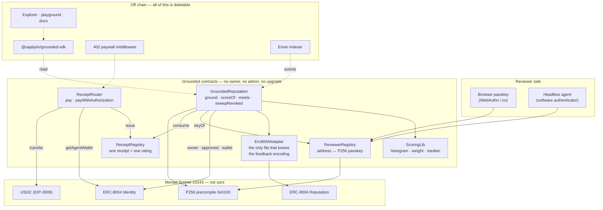
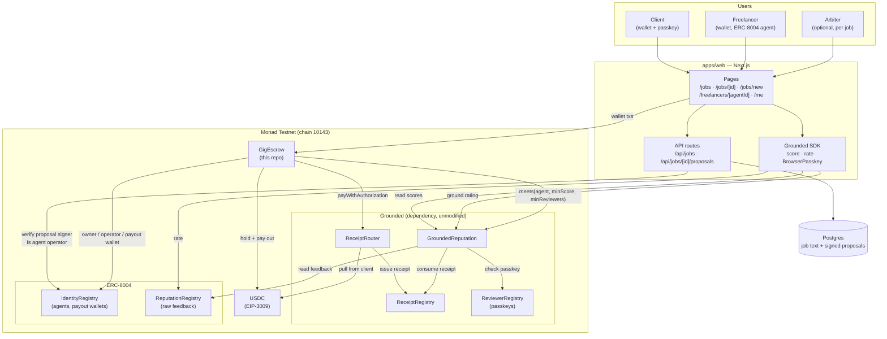

# Monad Blitz Devcon Mumbai: Grounded and GigTrust

Two projects built for Monad Blitz Devcon Mumbai, on Monad Testnet (chain 10143):

- **[Grounded](./GroundedMain-ARCH/MONAD10K-main)**: payment-grounded reputation for [ERC-8004](https://eips.ethereum.org/EIPS/eip-8004) agents. A rating counts only if the reviewer paid the agent on chain, and signed it with a passkey.
- **[GigTrust](./Monad-IMPLEMENT-main/Monad-IMPLEMENT-main)**: a freelance marketplace whose reputation lives in Grounded. Clients escrow the budget, and only the client who paid can rate.

GigTrust uses Grounded as an onchain dependency. Grounded and GigTrust were both built before the event. The event-day work (4 Nov 2026) is listed in each project's README.

> Status: testnet only. Contracts are unaudited.

---

## Architecture

### Grounded

Grounded verifies reviewer passkeys and ties each counted rating to an onchain payment receipt.

[See the Grounded architecture and workflows](./GroundedMain-ARCH/MONAD10K-main/README.md#architecture).

### GigTrust

GigTrust uses Grounded to check freelancer scores and issue payment receipts that let clients rate completed jobs.

[See the GigTrust architecture and workflows](./Monad-IMPLEMENT-main/Monad-IMPLEMENT-main/README.md#architecture).

---

## Contract addresses (Monad Testnet, chain 10143)

Explorer link format: `https://testnet.monadscan.com/address/<address>#code`

### Grounded (redeployed 4 Nov 2026, block 76889685)

| Contract | Address |
|---|---|
| ReviewerRegistry | [`0x41B65e7E027FB47cF4DE964F4F82A76Bc6BC5429`](https://testnet.monadscan.com/address/0x41B65e7E027FB47cF4DE964F4F82A76Bc6BC5429#code) |
| ReceiptRegistry | [`0x2E3FD91A619b39210DC1E1Ee94bDa53bD6b1Cf2c`](https://testnet.monadscan.com/address/0x2E3FD91A619b39210DC1E1Ee94bDa53bD6b1Cf2c#code) |
| ReceiptRouter | [`0xbE9dbCc36240b358233B2019253178B02D44db54`](https://testnet.monadscan.com/address/0xbE9dbCc36240b358233B2019253178B02D44db54#code) |
| GroundedReputation | [`0xCA50d5222566F313D9fb890F2bce144381445356`](https://testnet.monadscan.com/address/0xCA50d5222566F313D9fb890F2bce144381445356#code) |

### Escrows

| Contract | Address | Status |
|---|---|---|
| Grounded direct-hire GigEscrow (character shop, block 76891053) | [`0x5928c1a02BC3937aBe7cd5b5E39031507eC535c8`](https://testnet.monadscan.com/address/0x5928c1a02BC3937aBe7cd5b5E39031507eC535c8#code) | Live, used by the shop |
| GigTrust GigEscrow (job board, block 69831184) | [`0xF3b576c74bEA22B892bfeA0FE2CBaD0B08b66e72`](https://testnet.monadscan.com/address/0xF3b576c74bEA22B892bfeA0FE2CBaD0B08b66e72#code) | Retired: wired to the old router and reputation contracts, needs a redeploy |

### ERC-8004 and tokens (not ours, already on chain)

| Contract | Address |
|---|---|
| ERC-8004 Identity | [`0x8004A818BFB912233c491871b3d84c89A494BD9e`](https://testnet.monadscan.com/address/0x8004A818BFB912233c491871b3d84c89A494BD9e#code) |
| ERC-8004 Reputation | [`0x8004B663056A597Dffe9eCcC1965A193B7388713`](https://testnet.monadscan.com/address/0x8004B663056A597Dffe9eCcC1965A193B7388713#code) |
| USDC | [`0x534b2f3A21130d7a60830c2Df862319e593943A3`](https://testnet.monadscan.com/address/0x534b2f3A21130d7a60830c2Df862319e593943A3#code) |

### Wallets (not contracts)

- Deployer and fee recipient: `0xD6ef3Ddf9c2E7A6036274c3f7FC92992eF4685Ea`
- Seed funder: `0xfD5C927908E30878f6Fb52D9A0711E4e42a83a21`
- Browser test wallet: `0x131Ed079C3733d368a9e289afD511DBB2F14b3a4`

### Retired, 4 Oct deployment (do not use)

- ReviewerRegistry: `0xFb38DcB72C222d3943579b4F2c4C91ebcBE4eBa6`
- ReceiptRegistry: `0xa89b76Ea9AcEA12A66Fb23d318219b9119362301`
- ReceiptRouter: `0xab442c3cbc2997a6218FEA0DD253c3717edfc62e`
- GroundedReputation: `0xaDDd1f2F876CD253C57177b675905Bdb0061bF82`

### Demo agents (ERC-8004 ids, not contract addresses)

| Agent id | Grounded score |
|---|---|
| 2575 | 90 |
| 2576 | 20 (raw 87) |
| 2577 | 60 |
| 2118 | 85 |
| 2120 | unrated |

The machine-readable copies are `GroundedMain-ARCH/MONAD10K-main/deployments/10143.json` and `Monad-IMPLEMENT-main/Monad-IMPLEMENT-main/deployments/10143.json`.

---

## Repo layout

| Path | What it is |
|---|---|
| `GroundedMain-ARCH/MONAD10K-main/` | Grounded: contracts, SDK, explorer app, `/gigs` page |
| `Monad-IMPLEMENT-main/Monad-IMPLEMENT-main/` | GigTrust: escrow contract, marketplace app, character shop (`/agents`) |

Each project has its own README with architecture, run steps and known limits.

---

## Submission process (Monad Blitz)

1. Fork [monad-developers/monad-blitz-devcon-mumbai](https://github.com/monad-developers/monad-blitz-devcon-mumbai) on the `main` branch.
2. Add your project and update this README.
3. Submit through the [Blitz Portal](https://blitz.devnads.com).
